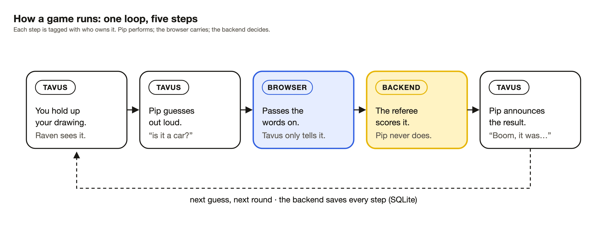
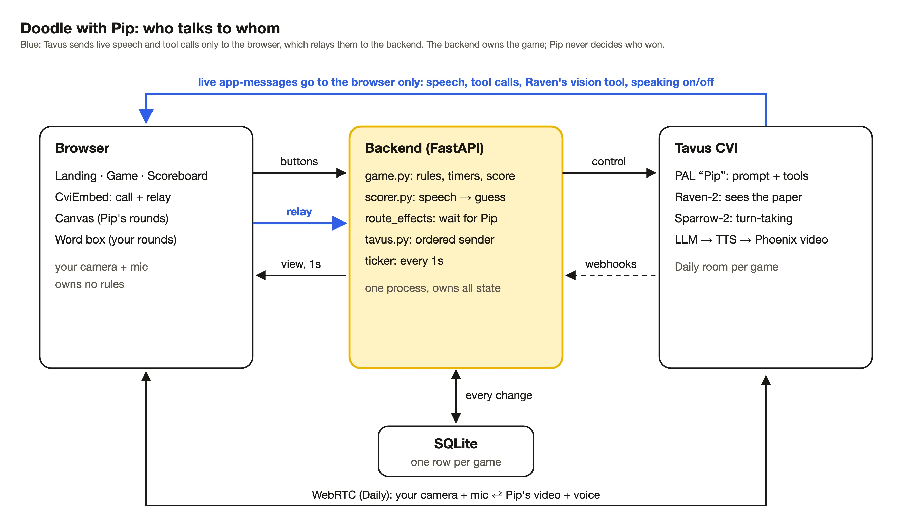

# Doodle with Pip

**Pip guesses your doodles out loud. Then you guess Pip's.** A turn-based drawing game against a live Tavus video human.

- **Play it:** **https://doodle-with-pip.onrender.com** (no login; grab paper and a thick pen, allow camera and mic. Free hosting: the first load after a quiet spell takes about 50 seconds)
- **Watch it:** https://youtu.be/hA5SKsZd5HE (a full game, start to finish; see [Demo](#demo))
- **Run your own copy:** `git clone https://github.com/Suvoo/No-Way-Pictionary.git && cd No-Way-Pictionary && make up`, then open http://localhost:8080 ([details](#run-it-yourself))
- **AI agents** (Claude Code, Cursor, Codex...): read [`AGENTS.md`](AGENTS.md) first. It covers the read order, commands, the rules that must not break, and where to change things.

---

<a name="demo"></a>
<details open>
<summary><h2>Demo</h2></summary>

[](https://youtu.be/hA5SKsZd5HE)

**▶ [Watch the demo on YouTube](https://youtu.be/hA5SKsZd5HE)**: one full game, 6 rounds, me against Pip. (GitHub can't play videos inside a README, so the picture opens YouTube.)

</details>

---

<a name="what"></a>
<details open>
<summary><h2>What</h2></summary>

You and Pip, an AI on a live video call, take turns drawing. There are 6 rounds of 45 seconds each, and each guesser gets 3 tries.

- **Your rounds:** you get a secret word that Pip can't see. You draw it on **real paper** and hold it up to the camera. Pip watches through Tavus Raven-2 and guesses out loud: "Two circles... is it a car?"
- **Pip's rounds:** Pip sketches its secret word on a canvas, one stroke at a time, and you shout your guess.
- **Scoring:** a right guess within 3 tries scores 1 point for the guesser. A miss scores nobody. Say your word out loud or write it on the paper, and you get a new word; do it twice and Pip gets the point.

> **A PAL is a prompt. This is a system.** Pip, the Tavus PAL, is one component: the face, the voice and the eyes. The game is everything around it, and none of that lives in the Tavus dashboard: a state machine, secrets kept on the right side, a referee that scores every guess, turn-taking that never talks over Pip, stroke templates, and a 50-case eval.

</details>

<a name="why"></a>
<details open>
<summary><h2>Why</h2></summary>

**Games are where new tech proves itself.** Much of computer science has tested its proofs of concept on games, and games have pushed it forward. Games drove graphics and physics simulation. Reinforcement learning grew up on Atari games, then on Go and chess. Robots learned to play table tennis. Online games pushed live streaming, real-time communication and instant feedback. So whenever I want to know how good a technology really is, my first test is a game. Pictionary is a good one for real-time video AI: it needs eyes, a voice and a fast back-and-forth with someone who can draw back.

**And it is a game kids already play.** In libraries around the Bay Area, in Sunnyvale and San Jose, I see lots of children on iPads (the library's or their own). Many of the games they play most involve talking with a character, though an animated one, not a live human. Pictionary comes up a lot, and it is a good game for younger kids: it builds hand-eye coordination, gets them thinking in shapes, and makes them explain what they mean. A live character that watches your drawing, guesses out loud and draws back is a way for kids to practise those skills, learn new words and talk with someone while they play.

**Why it fits Tavus:**
- **It only works with video.** The camera has to see your paper, and you have to see Pip's canvas. Take the video away and there is no game, so it shows what CVI does that a chatbot can't.
- **Anyone can test it in 45 seconds.** Draw a terrible bicycle and laugh when Pip asks "is that a car?".
- **It is new on Tavus.** There is no Pictionary or sketch-guessing build in the Tavus Community Showcase or the official examples (checked Nov 26 2026). Outside Tavus, the closest things are Pictionary Vs. AI and Quick, Draw!, and both are one-sided: you draw, a classifier guesses, and nobody draws back.

**Success measure:** a full game finishes in 6 to 7 minutes with a final score, all 6 words and who scored each round. The guess log (in the API and the database) shows every guess, how many tries it took, and whether it was right.

</details>

---

<a name="architecture"></a>
<details open>
<summary><h2>Architecture</h2></summary>

### 1. The loop: who owns each step



**Pip performs, the browser carries, the backend decides.** Tavus sends live speech only to the browser, so the browser relays every sentence to the backend. The backend is the only thing that scores, and Pip never grades itself.

### 2. The system: who talks to whom



- **Browser** (React): renders whatever the backend says and owns no rules. It joins the Tavus call (a Daily WebRTC room) and relays Pip's live events to `POST /api/games/{id}/events`.
- **Backend** (FastAPI, one process): owns all game state, timers, secrets and scoring, and stores each game in SQLite. It steers Pip with `send-app-message` (silent context, "answer in your own words", "say this line exactly").
- **Tavus CVI:** Pip the PAL, made of Raven-2 vision, turn-taking, LLM, voice and face, with two tools: `draw_next_stroke` and the Raven vision tool `written_word_on_paper`. **Pip is defined in code** (`backend/setup_tavus.py`), and the server creates or updates it on your Tavus account at startup.
- **Secrets:** in your rounds the word goes only to the browser. In Pip's rounds the word goes only to Pip, and the browser gets stroke shapes but never the word.

### 3. One round, from a doodle to a point


The backend never talks over Pip. It holds every line until Pip finishes speaking, then has Pip say the reveal word for word, and the screen shows the answer only once Pip says it.

<details>
<summary><b>Architecture in depth</b>: routes, message types, the state machine, the referee rules, tools, webhooks</summary>

The same system in text, with the real routes and message types:

```
BROWSER  React + Vite + Tailwind (built and served by the backend in production)
│  Landing -> Game -> Scoreboard. Renders whatever the backend returns; owns no rules.
│  CviEmbed.tsx: joins the Daily room, shows Pip's video + your camera preview, and relays
│                Tavus app-messages (speech, tool calls, Raven vision tool, started/stopped speaking)
│
│  POST /api/games ...................... create a game + its Tavus conversation -> room URL
│  POST /api/games/{id}/events .......... relayed app-messages (the only way speech reaches the backend)
│  POST /api/games/{id}/start-round|look|guesses|hint|next-stroke|complete ... buttons and typed guesses
│  GET  /api/games/{id} ................. polled every 1s -> public view (never Pip's secret word)
▼
BACKEND  FastAPI, one process, owns ALL game state
│  game.py ......... state machine, timers, scoring. Pure: returns effects (what Pip should hear or say)
│  scorer.py ....... speech -> scored guess (matching, near misses, voice commands)
│  route_effects ... (in game.py) holds Pip's spoken lines until Pip stops talking; drops stale prompts
│  tavus.py ........ sends effects to Tavus one at a time, in order (demo mode: logs them instead)
│  prompts.py ...... everything Pip is told     store.py ... SQLite, one row per game
│  webhooks.py ..... HMAC-verified callbacks    inspect_game.py ... `make last-game`
│
│  POST /v2/conversations ........................ create the call: pal_id, per-game context, greeting
│  POST /v2/conversations/{id}/send-app-message
│       overwrite_llm_context / append_llm_context ... round context and secrets (silent)
│       respond ...................................... Pip answers in its own words (nudges, round starts)
│       echo ......................................... Pip says this exact line (reveals)
│       tool_result .................................. answer to Pip's draw_next_stroke
│  POST /v2/conversations/{id}/end ............... at game over, Home, Play again or Quit
▼
TAVUS CVI
   PAL "Pip", defined in setup_tavus.py and synced to Tavus at every server start: system prompt,
     Raven-2 with paper-focused awareness questions, speech hotwords, turn-taking settings,
     draw tool (LLM) + written_word_on_paper (Raven vision tool)
   Conversation = a Daily WebRTC room: Raven-2 sees -> Sparrow-2 turn-taking -> LLM -> TTS -> Phoenix video
   Live app-messages go to the BROWSER only (hence the relay); post-call callbacks -> POST /webhooks/tavus
```

**Browser.** One page: landing, then game, then scoreboard. It renders whatever state the backend returns and owns no rules. The canvas is shown **only** in PAL-draw rounds, and the word box only in yours, so paper stays the input and canvas the output. Layout: the live video is the stage (two thirds of the width on desktop) and the round's controls sit in a slim rail; on phones they stack. `CviEmbed.tsx` joins the Daily room with a Daily *call object* and draws the tracks itself: Pip's video fills the stage, the player's camera is a small corner preview for aiming the paper, Pip's lines appear as captions, and there is no stock pre-join screen. It also **relays** Tavus app-messages (`conversation.utterance`, `conversation.tool_call`, `conversation.perception_tool_call` with its camera frames stripped, `started/stopped_speaking`) to the backend, because Tavus delivers those only to the browser (see "Tavus API notes" under Reference).

**Backend state machine (`game.py`).** `ROUND_START -> USER_DRAW | PAL_DRAW -> REVEAL -> ... -> GAME_OVER`. Rules enforced in code, not in the prompt: 45s timer (server clock, 3s grace for speech lag), 3 guesses, no duplicate words per game, a repeated guess does not burn a try, auto-stroke every 7s if the PAL stalls (narrated out loud only when nobody is talking), a single nudge after 15s of player silence in Pip's rounds, and in the player's rounds a "look at the camera now" prompt whenever the PAL has been quiet for about 9s (up to 3 a round). If the player says their own word out loud, they get a new word and a fresh round; a second time, Pip gets the point. A user utterance that Tavus re-sends as it grows ("No, I think-" then "No, I think- drummers") is scored once, on its new words only. It is pure: it takes `now` and returns *effects* (messages for the PAL) instead of calling Tavus, which is why the eval can replay rounds without a video call.

**Secret handling.** The backend knows every word but tells one side at a time:
- *Your round:* the word goes to the browser only. The PAL gets "the player is drawing, you do not know the word".
- *Its round:* the word goes to the PAL only, via `conversation.overwrite_llm_context` at the moment the round starts (server-side, not broadcast to the room). The browser gets stroke geometry, never the word or the stroke labels. `test_api.py` and eval case 15 check this.
- Each round **overwrites** the PAL's context, so it never holds a future word or the player's word.

**Referee (`scorer.py` + `game.record_guess`).** The PAL never scores itself. Each rule below came from a live game and has an eval case.
- **Matching:** a guess is right if the word or a variant appears as a whole word ("bike" for bicycle, "kitty" for cat, "smile" for smiley face), ignoring case, punctuation and plurals.
- **Pip's guesses** are read from what it says out loud, so the score matches what the player heard: questions ("is it a cup?") count; exclamations count only if they name a game word ("it's a bicycle!", not "that's cheating!"); descriptions do not ("it looks like a scoop on a triangle"); if one guess in a sentence is right, only that one counts.
- **Player guesses** come from speech or the typed box: short utterances are guesses; questions ("What is it?") and filler ("Of it.") are not; in a longer sentence, a game word is the guess ("I just said a ladder"). A guess one or two letters off ("slow man" for snowman) is a likely mishearing: it does not use up a try, and Pip asks again. A growing utterance that Tavus re-sends is scored once.
- **Voice commands:** between rounds, "let's start", "ready", "go" or "next round" do what the button does; "not ready" and "wait" win.

**Not talking over the PAL (`game.route_effects`).** Every line the backend makes the PAL say is a new turn that interrupts whatever it is saying, so the backend tracks `started/stopped_speaking` (and estimates the length of the PAL's own sentence, about 0.36s a word) and holds those lines until the PAL finishes, max 8s. Stale timer prompts are dropped. Reveals are fixed lines spoken word for word with `conversation.echo`, and always name the word: "Boom, it was glasses.", "Yes! It was heart. Point to you.", "Time's up! It was pizza. No point this round." The screen waits too: until the PAL has finished the guess and the announcement goes out, the browser shows "Checking Pip's guess..." instead of the answer (`reveal_ready` in the game view), and starting the next round (button or voice) waits for it, so the reveal lands with Pip's voice instead of spoiling it.

**PAL tools (`tools.py`).** `draw_next_stroke()` for its drawing (LLM tool). `written_word_on_paper(text)` is a Raven **vision** tool: Raven fires it by itself when it sees writing on the paper, the browser relays it without the camera frames, and the backend checks the text against the secret word. (A `submit_guess` tool was retired after two live games: the PAL never called it, so the referee scores what the PAL says out loud, which is also what the player hears.) The PAL decides *when* to draw, and the template decides *what* is drawn, so it cannot draw nonsense or the wrong word. `reveal_answer` (`game.end_round`) is backend-only on purpose, so the PAL cannot end a round early. The hint is a player button, enabled only in PAL-draw rounds, because a hint in your round would leak your word to the PAL.

**Canvas and stroke templates (`strokes.json`).** 28 words, 2 to 6 strokes each, as plain shapes (line, circle, ellipse, arc) in a 100×100 box. They are rendered as rough black marker lines with a little deterministic wobble, and each new stroke animates in like a pen. Add a word: one entry in `words.py`, one template in `strokes.json`, then `make eval`.

**Webhooks (`webhooks.py`).** `X-Tavus-Signature` (HMAC-SHA256 of the raw body) is verified before parsing, and unsigned requests get 401. Events are deduplicated, and processing failures return 500 so Tavus retries. Webhooks store the post-call transcript for the audit trail. Live gameplay does not depend on them.

**Storage (`store.py`).** SQLite, one row per game as JSON, saved after every change inside one lock, so a backend restart resumes the game.

</details>

</details>

---

<a name="run-it-yourself"></a>
<details open>
<summary><h2>Run it yourself</h2></summary>

There are three ways to try it:

| Who | What they do | What they get |
|---|---|---|
| **Just wants to play** | Opens https://doodle-with-pip.onrender.com | The full live game with Pip, on the hosted key. Nothing to install |
| **Runs it locally, no key** | `make up` and nothing else | **Demo mode:** the same game with no video call. Rounds, timers, secret words, referee and scoring all run for real; you type what Pip "says" in your rounds and your guesses in Pip's |
| **Runs it locally, own key** | Puts `TAVUS_API_KEY=their-key` in `.env`, then `make up` | The full live game on their own account. On first start the server creates Pip on **their** Tavus account, and calls use **their** credits |

### Run it locally

**Prerequisite: Docker** ([Docker Desktop](https://www.docker.com/products/docker-desktop/) on Mac or Windows, installed and **running**; it includes Docker Compose). That's it: no Python, Node or database to install.
- `git` to clone, or use **Code > Download ZIP** on GitHub instead.
- `make` is optional. It's only a shortcut, and `docker compose up --build` does the same thing.
- A Tavus API key is optional: without one it runs in demo mode.

1. **Clone it and start it:**
   ```bash
   git clone https://github.com/Suvoo/No-Way-Pictionary.git && cd No-Way-Pictionary
   make up        # or: docker compose up --build
   ```
2. **Open http://localhost:8080.** Without a key this is demo mode.
3. **For the live video human**, put your Tavus key in `.env` (`make up` created that file from `.env.example`), then run `make up` again:
   ```bash
   TAVUS_API_KEY=your-key
   ```
   That's all. On the first start the server **creates Pip** on your Tavus account (PAL, Raven-2, hotwords, turn-taking and both tools) and logs `pip ready: <pal_id>`. Every later start finds that same Pip by name and changes nothing, unless the code changed Pip's prompt or settings; then it updates it in place. There are no duplicates, you don't need a PAL id, and there's no setup script.
4. **Check it is up:** `curl localhost:8080/health` returns `{"ok": true, "mode": "live"}` (or `"demo"`). Stop it with `make down` (or Ctrl+C).

**Windows:** install Docker Desktop and run `docker compose up --build` (Windows has no `make`). For live video, first run `copy .env.example .env` and add your key.

### For AI agents

Give an agent the repo and this prompt:

> Read `AGENTS.md`, then run `make up` and confirm `curl localhost:8080/health` returns ok.

`AGENTS.md` is the agent's map (Cursor, Codex, Copilot and others read it automatically; `CLAUDE.md` imports it for Claude Code): what to read first, the one command to run, the rules the tests enforce, where each kind of change goes, and how to debug a live game. After any code change, the agent runs `make check` (eval, tests and frontend build; needs Python 3.9+ and Node 20+).

### Deploy it (one service)

It's the same Docker image everywhere. The image builds the React app and FastAPI serves it, so you get one URL, one service and no CORS. It needs an always-on container (the backend runs the round timers) and HTTPS (browsers only allow camera and mic on HTTPS).

- **Render** (free tier, configured): New > Blueprint > this repo (`render.yaml`). Set **`TAVUS_API_KEY`**; everything else is optional or automatic. The free tier sleeps after 15 idle minutes, so open the link once before sharing it.
- **Railway, Fly.io, Cloud Run, any Docker host:** build the `Dockerfile` and set `TAVUS_API_KEY` and `PORT`. Set `PUBLIC_URL` to your https URL and `TAVUS_CALLBACK_SECRET` to any random string to get signed post-call webhooks. On Cloud Run, run exactly one instance (one process owns the timers and the SQLite file).
- **Verify:** `curl https://<your-app>/health` returns `{"ok": true, "mode": "live"}`. Then play once in an incognito window and once on a phone.

| Env var | Needed | What |
|---|---|---|
| `TAVUS_API_KEY` | for live video | Tavus API key. Stays on the server and never reaches the browser |
| `TAVUS_PAL_ID` | no | pin a specific PAL; empty = find or create Pip by name |
| `PUBLIC_URL` + `TAVUS_CALLBACK_SECRET` | no | signed webhooks (post-call transcript). On Render the URL is automatic and the blueprint generates the secret |
| `TAVUS_FACE_ID` | no | a stock face from the Tavus Face Library |

<details>
<summary><b>Working on the code</b>: dev server with hot reload, all commands</summary>

Needs Python 3.9+ and Node 20+.

```bash
make setup     # once: venv + pip + npm, copies .env.example to .env
make dev       # backend :8000 + frontend :5173 with hot reload -> http://localhost:5173
make check     # eval (50 cases) + API/unit tests + frontend build. Run after every change
```

| Command | What it does |
|---|---|
| `make up` / `make down` | run / stop the whole app in Docker on :8080 (the way to just use it) |
| `make dev` | backend + frontend with hot reload |
| `make eval` | golden-set eval, prints pass/fail per case |
| `make test` | API and unit tests (secrets, idempotency, webhooks, garbage input, not talking over Pip, Pip auto-setup) |
| `make check` | eval + tests + frontend build |
| `make last-game` | what happened in the latest game: rounds, every guess and why it counted, turn latency |
| `make stop` | free ports 8000 / 5173 if a dev server was left running |
| `make tavus-setup` | optional: the same Pip sync the server runs at startup, by hand (`--dry-run` prints the JSON) |
| `make docker` | the production image without compose, on http://localhost:8080 |

</details>

</details>

---

<a name="does-it-work"></a>
<details open>
<summary><h2>Does it work?</h2></summary>

- **Eval: 50/50 pass.** These are scripted cases, many of them replays of real live games, run against the real engine with a fake clock: scoring, timers, synonyms, mishearings, secrets, giving the word away, exact reveal lines and the idle goodbye. `make eval`.
- **Tests:** API, game timing, webhooks, secrets, and Pip auto-setup against a fake Tavus. `make test`.
- **Live:** nine games (29 rounds) against the real Pip. Secrets held every time, and the median turn latency was 0.88s. Every bug those games found is now an eval case labelled "Live replay".
- **Perception spike (before building):** Raven-2, 5 easy words, a thick marker, good light: 5/5 guessed within 3 tries. That's the only perception accuracy claimed.

<details>
<summary><b>Full eval results, live testing, and how you know Pip isn't making things up</b></summary>

**You don't have to trust the PAL.** The backend picks the words, keeps each secret on the right side, checks every spoken guess against the secret, and logs every guess with a timestamp, its source (tool, transcript, speech, typed) and why it did or did not count. The PAL talks; the backend referees.

1. **Measured spike (before building, Nov 26 2026):** a Raven-2 PAL, 5 easy words (star, house, fish, bicycle, cat), thick black marker, held steady for 3s, good room light, real phone browser: **5/5 correct within 3 guesses.** That is the only perception result claimed. It is 5 easy words, not all 345 categories.
2. **Golden-set eval (`make eval`):** 50 scripted cases (including replays of real live-game transcripts) replayed against the real engine with a fake clock. They prove the game logic: scoring, timers, synonyms, repeats, secret handling, giving the word away (said or written), the honesty fallback, exact reveal lines, and that the PAL cannot guess in its own round.
3. **Live audit trail:** every guess is stored with its raw text, source and why it did or did not count, in the database and in `GET /api/games/{id}/scoreboard` (`guess_log`). Players see only the words and who scored; anyone checking the game can re-score it by hand from the log.

```
PASS  # 1  Easy word, clear drawing: PAL guesses star first try
PASS  # 2  Medium word: PAL commits to car, changes its mind to bicycle
PASS  # 3  Hard word is excluded from the v1 word bank
PASS  # 4  Wrong guess then correct: scored after 2 guesses, not 1
PASS  # 5  Timer expiry: no correct guess in 45s, nobody scores, game advances
PASS  # 6  No duplicate words in a game (200 seeds), Play Again avoids last game's words
PASS  # 7  PAL-draw round: player says house after stroke 3
PASS  # 8  PAL-draw round: player wrong 3 times, reveal shows key, nobody scores
PASS  # 9  Silent player: PAL nudges once after 15s, backend keeps drawing
PASS  #10  Cannot see paper: honesty fallback is logged, not counted as a guess
PASS  #11  Synonym counts: 'kitty' is accepted for cat
PASS  #12  Repeated wrong guess does not burn a second guess
PASS  #13  Guess 2.5s after the buzzer still counts (speech lag grace)
PASS  #14  Late guess after grace window is rejected
PASS  #15  Anti-cheat: PAL-draw word never appears in what the browser sees
PASS  #16  Player says their own word: it is replaced with a new word and Pip's guesses reset
PASS  #17  PAL tries to guess in its own drawing round: refused
PASS  #18  Every v1 word has 2-7 template strokes and a hint
PASS  #19  Live replay (Nov 26): a growing utterance is one guess, not three
PASS  #20  Live replay (Nov 26): PAL that has not guessed is prompted to look, then again if still quiet
PASS  #21  A PAL that keeps talking and guessing is not prompted
PASS  #22  Auto-stroke is narrated out loud only when nobody is talking
PASS  #23  Live replay (Nov 26): prompted to look at ~9s, then again when it goes quiet after a wrong guess
PASS  #24  Live replay (Nov 26): saying "No, let's start." starts round 1 by voice
PASS  #25  "I'm not ready yet" does not start the round
PASS  #26  Saying "Next round!" after a reveal starts the next round
PASS  #27  Live replay (Nov 26): "slow man" for snowman is a near miss, not a wasted guess
PASS  #28  Short words are never near misses: "car" for cat is a real wrong guess
PASS  #29  Live replay (Nov 26): "What is it?" is a question, not a wasted guess
PASS  #30  Live replay (Nov 26): "Uh, bro, I just said a ladder?" counts as the guess ladder
PASS  #31  Live replay (Nov 26): voice start of a player round sends no second scripted line
PASS  #32  Long chatter without a game word is still not a guess
PASS  #33  Live replay (Nov 26): "it looks like a scoop on a triangle" is a description, not a wasted guess
PASS  #34  Live replay (Nov 26): when Pip guesses right, it says exactly "Boom, it was ice cream."
PASS  #35  When the player guesses Pip's drawing, Pip says "Yes! It was heart. Point to you."
PASS  #36  Live replay (Nov 26): "A heart and a cone... is it an ice cream?" guesses ice cream, not heart
PASS  #37  Guessers-only scoring: a missed round scores for nobody, a right guess scores for the guesser
PASS  #38  Live replay (Nov 26): "The word is fish, bro." swaps the word; "that is cheating!" is not a guess
PASS  #39  Saying the word a second time in the same round gives Pip the point
PASS  #40  Live replay (Nov 26): "Of it." is speech debris, not a wasted guess
PASS  #41  Live replay (Nov 26): "a smile" counts for smiley face
PASS  #42  Pip's exclamation counts only when it names a game word ("Wait, it's a bicycle!")
PASS  #43  After a word swap, Pip may guess an old guess again on the new word (not "already tried")
PASS  #44  Writing the secret word on the paper (Raven's vision tool) swaps the word, like saying it
PASS  #45  Other writing Raven sees (a logo, a label) is ignored, not a penalty
PASS  #46  Writing the new word too gives Pip the point, and the reveal says so
PASS  #47  Live replay (Nov 27): "Yo, I don't want to play, should we just talk?" - chatting does not keep the call open past 3 minutes
PASS  #48  Starting a round before 3 minutes cancels the goodbye
PASS  #49  Between rounds, 3 minutes without "next round" also ends the call
PASS  #50  A long round is never cut by the idle goodbye (only waiting states count)

50/50 passed
```

**Live testing (Nov 26 2026):** nine games (29 rounds) against the live PAL. Secrets held in every game. Measured turn latency, from the player stopping talking to the PAL starting, had a median of 0.88s over 49 turns (2 readings were excluded: the PAL was answering a backend line, not the player, a measurement bug since fixed). Every problem the games surfaced is fixed and replayed as an eval case labelled "Live replay": a growing utterance scored three times, the PAL waiting to be spoken to before looking, mishearings, the PAL misreading who won, the backend cutting the PAL off mid-sentence, the player saying their own word, and more.

**What the eval does not prove:** that Raven reads every drawing, or that the PAL always follows its prompt (phrases guesses as questions, waits its turn, says "hold it closer" instead of guessing), or that Raven's vision tool spots every written word. Cases 9 and 10 check the *backend* side of those behaviours (the nudge fires, an "I can't see" line is not counted, the prompt contains the rule). Whether the PAL follows the rule live is checked by playing, and the guess log records what it did.

</details>

</details>

---

<a name="reference"></a>
<details open>
<summary><h2>Reference</h2></summary>

<details>
<summary><b>How to play, in detail</b></summary>

1. Open the link, grab paper and a **thick black pen**, press **Play**, allow camera and mic. Pip says hi and asks if you want the rules; ask anything, then say **"let's start"** (or press Start).
2. **Round 1 (you draw):** you see a secret word the AI cannot see. Draw it (no letters) and hold it up; Pip looks on its own, and **Look now** hurries it. It guesses out loud: right within 3 guesses and it scores a point. Say or write your word and you get a new one; do it twice and Pip gets the point.
3. **Round 2 (it draws):** a canvas appears. It draws its secret word stroke by stroke. Shout your guess (or type it). Get it within 3 guesses and you score a point.
4. Alternate for 6 rounds, 45 seconds each. Final scoreboard with every word and who scored each round.

Scoring: **guessers only.** Guess right within 3 tries and you get the point; a missed round scores for nobody. So the score is who guessed more, and drawing badly on purpose never pays. (An earlier rule gave the drawer the point on a miss, which rewarded bad drawings.)

</details>

<details>
<summary><b>API</b></summary>

All `/api/games/{id}/...` routes need the `X-Player-Token` header returned by `POST /api/games`. Every mutating route returns the same game view as `GET`.

| Method & path | Purpose |
|---|---|
| `GET /health` | `{"ok": true, "mode": "live" \| "demo"}` |
| `GET /api/config` | rounds, seconds, guesses, PAL name, mode |
| `POST /api/games` | `{"previous_game_id"?}` -> creates a game + Tavus conversation |
| `GET /api/games/{id}` | game view (state, round, score, strokes, guess log) |
| `POST /api/games/{id}/start-round` | start round 1, or the next round from REVEAL |
| `POST /api/games/{id}/look` | your round: tell the PAL the paper is up, guess now |
| `POST /api/games/{id}/events` | browser relays a raw Tavus app-message (utterance, tool_call, perception_tool_call, started/stopped_speaking). Idempotent |
| `POST /api/games/{id}/guesses` | typed guess `{"text": "bike"}`. Demo mode: `{"text": "Is it a car?", "guesser": "pal"}` simulates the PAL |
| `POST /api/games/{id}/next-stroke` | PAL round: "draw more" button |
| `POST /api/games/{id}/hint` | PAL round: hint, after 2 wrong guesses or 20s |
| `POST /api/games/{id}/complete` | quit / finish: closes the Tavus conversation, returns scoreboard |
| `GET /api/games/{id}/scoreboard` | final score, all words, full guess log |
| `POST /webhooks/tavus` | Tavus callbacks, HMAC verified |

Example:

```bash
curl -s -X POST localhost:8080/api/games -H 'content-type: application/json' -d '{}'
# {"game_id":"Xk2..","player_token":"9fQ..","conversation_url":"https://tavus.daily.co/c123","mode":"live","rounds":6,"round_duration_sec":45,"pal_name":"Pip", ...}

curl -s -X POST localhost:8080/api/games/Xk2../start-round -H 'X-Player-Token: 9fQ..'
# {"state":"USER_DRAW","round":{"index":1,"drawer":"user","your_word":"bicycle","seconds_left":45,"guesses_left":3,"strokes":[],...},"score":{"user":0,"pal":0},...}

# a relayed utterance, exactly as Tavus sends it to the browser: Pip guesses out loud, the referee scores it
curl -s -X POST localhost:8080/api/games/Xk2../events -H 'X-Player-Token: 9fQ..' -H 'content-type: application/json' \
  -d '{"event_type":"conversation.utterance","inference_id":"i1","properties":{"role":"pal","speech":"Two circles... is it a car?"}}'
# {"handled":true}   (GET /api/games/Xk2.. now shows guesses_left 2 and "car" in guess_log)
```

</details>

<details>
<summary><b>Trade-offs, what was and wasn't built, known limitations</b></summary>

### Will build / will NOT build (v1)

**Built:** landing + game + scoreboard on one site · backend state machine, 6 alternating rounds · 28-word bank from Quick Draw · paper + camera + Raven-2 rounds · canvas + stroke template rounds · referee scoring + guess log · a PAL draw tool + a Raven vision tool (written word on the paper) · exact reveal lines · voice start · webhooks with HMAC · golden-set eval + API tests · demo mode with no key · one-service deploy.

**Not built, on purpose:** a second game mode, multiplayer, accounts, leaderboards · all 345 categories · image generation (sketch-like only) · a trained sketch classifier · auth, billing, payments · any accuracy claim beyond the spike.

### Trade-offs

1. **6 rounds × 45s × 28 easy words vs all 345 categories.** Chose depth and playability. Breadth would break guessing: Raven is a general perception model, not a sketch classifier.
2. **Backend referee vs letting the PAL score.** Chose the backend: reproducible, testable, cheat-proof. Cost: the backend has to parse speech (rules above, each with an eval case), with a typed box as a fallback.
3. **Stroke templates vs the LLM inventing coordinates.** Chose templates. Reliable, auditable, and the PAL still decides when to draw. Cost: 28 hand-made sketches, one per word.
4. **Follow the Tavus pattern: the browser relays live events, the backend referees.** Tavus delivers live speech, tool calls and speaking events only to the browser (over the Daily data channel); only webhooks, post-call actions, API-delivered tools and a custom LLM reach a server directly. Tavus's own apps work the same way: `tavus-interviewer` and `tavus-intake` handle the live transcript, guardrails and objectives in the browser and take their trusted result server-side after the call, and the `cvi-tool-calling` example even runs its tools in the browser. We go one step further: the browser only relays, and every decision is made on the server. Rejected: running our own LLM endpoint (Tavus's custom-LLM option) so the server sees every turn first-hand; it would remove browser trust but adds our own model to host and pay for, an extra hop of latency, and a rewrite of how Pip talks. Cost: see limitations.
5. **One service vs Vercel + Railway.** Chose one Docker service: one URL, no CORS, one thing to deploy. Split deploy still works.
6. **Live link + repo vs a recorded Loom only.** Chose both, with the live link primary (the team asked for a hosted link they can test), and a short Loom as backup.
7. **Pip defined in code vs set up by hand.** The server makes the PAL on your account match the code every time it starts, so a fresh clone with only an API key gets the right Pip, and prompt changes ship with a deploy. Cost: a few seconds of Tavus API calls at startup (no writes when nothing changed). Set `TAVUS_AUTO_SETUP=0` to turn it off.

### Known limitations

- **Relayed events are trusted (the Tavus pattern's trust boundary).** The backend believes what the player's own browser relays, so someone using the browser's developer tools could send fake events into **their own** game. They cannot touch other games (each has its own token), and they cannot fake a win in Pip's rounds because the browser never receives Pip's word. The realistic misuse is faking three wrong guesses from Pip in their own rounds so Pip does not score. Fixes, if it ever matters: compare the scored guesses with Tavus's post-call transcript (already received by the webhook) and flag mismatches, or have the server hear the call itself (a server-side Daily participant, or Tavus's custom-LLM option).
- **PAL turn-taking is prompt-level.** The PAL may talk over you or ask an unprompted question; that is a known CVI conversational limit. The prompt asks it to wait, and the referee ignores anything that is not a guess.
- **Speech-to-text can mishear** ("house" as "mouse"). The raw text is logged next to the scored guess so it can be audited, and the typed box is the escape hatch.
- **SQLite on a free host is ephemeral.** It survives a process restart, not a redeploy.
- **Free hosting sleeps.** On Render's free tier the first visit after 15 idle minutes takes about 50s.
- **One game per browser tab.** Two tabs means two separate games and two calls.
- **PAL guesses are read from its speech.** The prompt has it phrase guesses as "is it a ___?", and the referee extracts them with speech patterns. A guess phrased outside those patterns is missed, and the round ends on the timer instead.

</details>

<details>
<summary><b>Edge cases</b></summary>

Handled in v1: synonyms and plurals · repeated guesses · the same guess heard twice · late guesses (3s grace, then rejected) · speech-to-text near misses ("slow man" for snowman: not counted, the PAL asks again; never for 3-letter words) · starting by voice ("let's start", "ready", "next round"; "not ready" and "wait" win) · a growing or cut-off utterance (scored once, fragments ignored) · a PAL that waits instead of looking (prompted after ~9s of quiet) · timer expiry (nobody scores) · duplicate words in a game · Play Again avoiding the last game's words · the player saying their own word out loud (first time: a new word, a fresh 45s and Pip's guesses reset, with a warning on screen; second time in the round: Pip gets the point) · the player writing their word on the paper (Raven's `written_word_on_paper` vision tool reads it; if it is the secret word, same as saying it; other writing is ignored) · the PAL saying its own word (flagged) · the PAL guessing in its own round (refused) · "can't see, hold it closer" (logged, not a guess) · a silent player (one nudge + auto strokes) · a PAL that stops drawing (auto stroke every 7s) · duplicate webhooks and relayed events (idempotent) · garbage or malformed events (ignored, never crash) · a dropped call (Reconnect, same game) · a backend restart (state persisted after every change) · the conversation left open (closed at game end, on Home or Play again, plus a 20 min `max_call_duration` cap) · phones and tablets: a 🔄 button on the camera preview switches front and back cameras mid-call (shown only when the device has more than one camera; the back camera lets you lay the paper on a table) · off-topic chat (Pip answers in one sentence and steers back; if no round starts for 3 minutes, before round 1 or between rounds, Pip says a fixed goodbye and the backend ends the call, so a public link can't become an open-ended chat on your Tavus minutes).

Noted, not built in v1: holding up a phone image or print · a second person shouting guesses (no speaker ID) · lined or grid paper, a mirrored front camera, glare, shaky hands · rude drawings (prompt-level only) · rotating the phone mid-round · running out of Tavus minutes mid-game (the create call fails cleanly with a message, but there is no warning mid-game) · a slow connection delaying Raven's view.

</details>

<details>
<summary><b>What I would do with two more days</b></summary>

Check every scored guess against Tavus's post-call transcript and flag mismatches (closing most of the relay trust gap cheaply) · a small sketch classifier trained on Quick Draw as a second opinion next to Raven · a bigger word bank with difficulty tiers · calibration runs with real players (does 45s feel right? do people hold the paper steady?) · re-run the golden set plus a recorded live session after every prompt change, to catch drift · a post-call perception report on what Raven saw each round.

</details>

<details>
<summary><b>Tavus API notes (verified Nov 26 2026)</b></summary>

Checked against `https://docs.tavus.io/openapi.yaml` and the docs pages. If anything here disagrees with the live spec, the live spec wins.

- **Live utterances and tool calls go to the browser only**, over the Daily data channel (`conversation.utterance` with `role` `user` / `pal`, plus a legacy duplicate with `replica`; `conversation.tool_call`; `conversation.perception_tool_call`). Webhooks are lifecycle and post-call only. Hence the browser relay.
- **What does reach a server directly:** tools set to `delivery.api` (Tavus calls an HTTPS URL, HMAC-signed), post-call actions and webhooks (after the call), and a custom LLM (Tavus sends every turn to your OpenAI-compatible `/chat/completions`). Tavus's public apps (`tavus-examples`, `tavus-interviewer`, `tavus-intake`) handle live events in the browser and use the server for the API key and post-call results, the pattern this project follows (checked Nov 27 2026).
- **The server can push into a live call:** `POST /v2/conversations/{id}/send-app-message` accepts `overwrite_llm_context`, `append_llm_context`, `respond`, `echo` (say this text word for word), `tool_result` and more (120 req/min, 64 KB). This is how per-round secrets reach the PAL without ever sitting in its context early.
- **Current field names are `pal_id` + `face_id`.** The Santa Demo's `persona_id` / `replica_id` are the legacy names. PAL fields used: `pal_name`, `system_prompt`, `default_face_id`, `layers.perception.perception_model: "raven-2"`, `visual_awareness_queries`, `callouts`.
- **Speech and turn-taking settings on the PAL** (live findings): `layers.stt.hotwords` lists the 28 game words and the voice commands ("snowman" was transcribed as "slow man"), and `layers.conversational_flow` uses `turn_taking_patience: medium` and `pal_interruptibility: high`. We tried `high` patience after the PAL talked over a player, but every reply then felt late; medium patience plus high interruptibility (the PAL stops the moment the player speaks) is the balance. The browser also relays `conversation.started_speaking` / `stopped_speaking`, and the backend logs the gap from "player stopped talking" to "PAL started talking" for every turn (stored per game as `latencies`). The greeting is a short `custom_greeting` question; the PAL explains the rules in its own words from the per-conversation context.
- **Tools** are created with `POST /v2/tools` and attached with `POST /v2/pals/{id}/tools` (inline `layers.llm.tools` is legacy). Delivery `app_message` (default) goes to the browser; `delivery.api` makes Tavus call an HTTPS URL directly.
- **The conversation response** has `conversation_url` (for the Daily SDK; used here) and `room_url` (the Tavus-hosted page). End with `POST /v2/conversations/{id}/end`.

</details>

<details>
<summary><b>Files</b></summary>

```
AGENTS.md           guide for AI coding agents: read order, commands, invariants, where to change things
CLAUDE.md           one line: imports AGENTS.md for Claude Code
README.md           this file (source of truth)
Makefile            `make up` to run it; dev, check, last-game, docker for working on it
Dockerfile          one image: builds the React app, serves it from FastAPI
docker-compose.yml  what `make up` runs: the image on :8080, .env, ./data for SQLite
render.yaml         Render blueprint (one web service, health check /health)
.env.example        every env var, with comments
docs/               game-loop.jpg, architecture.jpg, one-round.jpg (the diagrams above)
backend/
  app.py            FastAPI routes (+ serves frontend/dist); sets Pip up at startup
  game.py           state machine, timers, rules, scoring, not-talking-over-Pip (start here)
  scorer.py         speech -> scored guess: matching, synonyms, near misses, voice commands
  prompts.py        system prompt + per-round context: everything the PAL is told
  tools.py          the PAL's tools: draw (LLM) + written_word_on_paper (Raven vision)
  words.py          28-word v1 bank (+ all 345 Quick Draw categories for reference)
  strokes.json      stroke templates, one per word
  store.py          SQLite persistence
  tavus.py          Tavus API client + ordered effect dispatcher, demo mode
  webhooks.py       HMAC verification + callback handling
  setup_tavus.py    Pip defined in code: find or create the PAL + tools, sync them (runs at startup)
  inspect_game.py   `make last-game`: one game's rounds, guesses and latency from the DB
  evals/            golden_set.json + run_evals.py (50 cases, many replaying live games)
  tests/            test_api.py (HTTP, secrets, webhooks), test_game.py (timing, holds, swaps),
                    test_setup.py (Pip auto-setup against a fake Tavus)
frontend/src/
  App.tsx  Landing.tsx  Game.tsx  CviEmbed.tsx  Canvas.tsx  Scoreboard.tsx  api.ts
```

</details>

Word bank from the [Google Quick, Draw! dataset](https://github.com/googlecreativelab/quickdraw-dataset) (CC BY 4.0). heart is a hand-added word; boat and balloon map to Quick Draw's "sailboat" and "hot air balloon".

</details>
